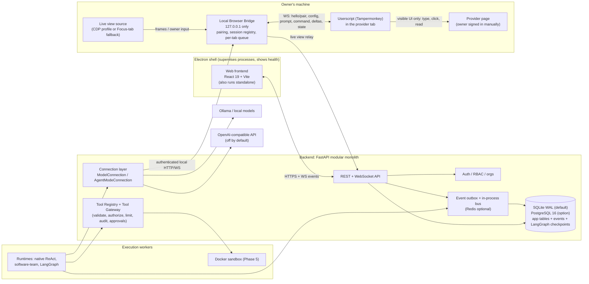
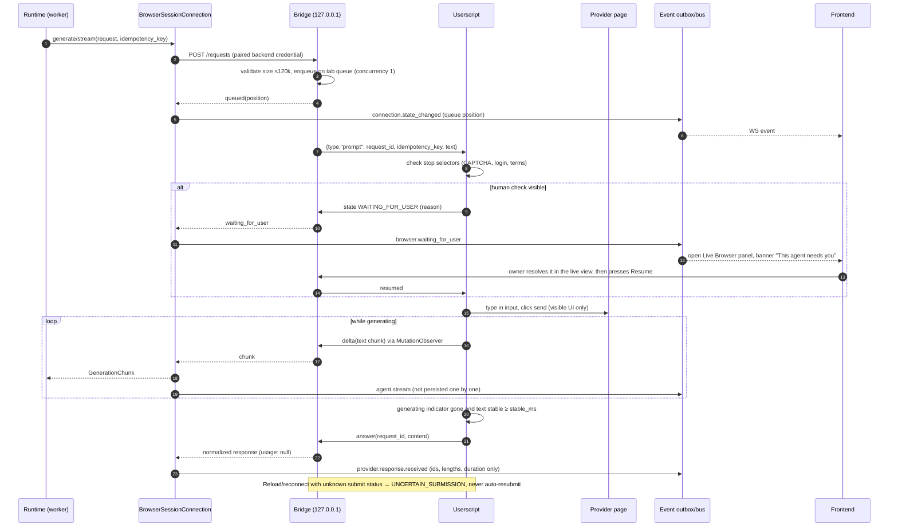

# System Design

Target design from SPEC §4, refined by Phase 0 research. Nothing here is implemented yet.

## 1. Components



## 2. Data flow: a browser-session request



## 3. Data flow: a run (native ReAct runtime)

```mermaid
sequenceDiagram
  autonumber
  participant UI as Frontend
  participant API as Backend API
  participant DB as DB (runs, events, checkpoints)
  participant W as Worker
  participant CN as ModelConnection
  participant G as Tool Gateway

  UI->>API: POST /runs (agent_version_id, input)
  API->>DB: tx{ insert run; insert event run.created }
  API-->>UI: run_id
  W->>DB: claim run (job queue)
  W->>DB: tx{ run.started }
  loop until done or a limit is hit (max steps, timeout, max tool calls)
    W->>CN: generate/stream (native tools or text action protocol)
    CN-->>W: action or final answer
    alt tool call
      W->>G: call(tool, args)
      G->>G: allow-list, JSON-Schema validate, limits, audit
      opt requires_approval
        G->>DB: tx{ approval row; approval.requested }
        DB-->>UI: WS event, approval card in chat
        UI->>API: approve / reject
        API->>DB: tx{ approval.approved | approval.rejected }
      end
      G->>DB: tx{ tool.execution.started / completed / failed }
      W->>W: loop detection (repeated identical action)
    end
    W->>DB: tx{ checkpoint.created (per step) }
  end
  W->>DB: tx{ run.completed | run.failed | run.cancelled }
  DB-->>UI: events over WS; reconnecting clients replay after last event_id
```

## 4. Key invariants

- The bridge binds 127.0.0.1 only. Every WS handshake checks Origin and a paired credential.
- The events table is the authority. Each event is written in the same transaction as its state change, and published only after commit.
- `sequence` is monotonic per run.
- Browser-session usage is always `null`. Bridge logs hold ids, lengths, durations and states only.
- The frontend never owns execution state.
